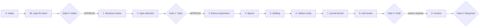

# Research Paper Agent

[](LICENSE)
[](https://www.python.org/)
[]()
[](https://www.overleaf.com/)

> **An autonomous, harness-agnostic AI agent framework that takes theory-heavy academic papers (formal symbolic proofs + small reproducible simulations) from journal intake to peer-reviewed submission.**

---

## 📖 Table of Contents

- [Overview](#-overview)
- [Goals & Purpose](#-goals--purpose)
- [Capabilities: What It Can & Cannot Do](#-capabilities-what-it-can--cannot-do)
  - [What It CAN Do](#what-it-can-do)
  - [What It CANNOT Do (Deliberate Boundaries)](#what-it-cannot-do-deliberate-boundaries)
- [Architecture & Multi-Harness Parity](#-architecture--multi-harness-parity)
- [The 11-Stage Pipeline](#-the-11-stage-pipeline)
- [Prerequisites & System Requirements](#-prerequisites--system-requirements)
- [Installation & Quick Start](#-installation--quick-start)
- [How to Run: Harness-Specific Examples](#-how-to-run-harness-specific-examples)
  - [Claude Code](#1-claude-code)
  - [OpenCode](#2-opencode)
  - [Google Antigravity](#3-google-antigravity)
  - [Cursor / Roo Code / Cline / Other Agents](#4-cursor--roo-code--cline--other-agents)
- [Human Feedback & Approval Channels](#-human-feedback--approval-channels)
- [Workspace & Output Directory Structure](#-workspace--output-directory-structure)
- [Publishing to GitHub (Keeping Your Research Private)](#-publishing-to-github-keeping-your-research-private)

---

## 🔬 Overview

Writing high-impact, theory-focused academic manuscripts is demanding. Mathematical proofs must be mathematically sound, simulation results must be reproducible, citations must be authentic and recent, and the final document must adhere strictly to publisher formatting rules.

**Research Paper Agent** is an end-to-end framework designed to automate the mechanics of writing academic research papers while keeping the human researcher in control of all high-level scientific decisions. 

It is completely **agent-agnostic and harness-agnostic**: whether you use Claude Code, OpenCode, Google Antigravity, or Cursor, you get the exact same deterministic CLI toolchain, skills, guardrails, and validation routines.

---

## 🎯 Goals & Purpose

The framework was built to solve common pitfalls when using generative AI for research:

1. **Eliminate Hallucinations**:
   BibTeX entries are never typed or recalled from memory; every citation is fetched and verified against Crossref, arXiv, or Semantic Scholar using persistent identifiers.
2. **Guarantee Mathematical & Empirical Integrity**:
   Mathematical derivations are symbolically verified with SymPy. Numerical simulation figures and values are tied directly to deterministic Python runs—no number enters the manuscript text without a traceable entry in `results/manifest.json`.
3. **Enforce Recency & Relevance**:
   All citations must be $\le 10$ years old, with at least 80% published within the last 5 years. Any older source requires an explicit, written justification.
4. **Preserve Human Agency**:
   Four mandatory gates stop the pipeline until the human confirms the target journal, selects the topic, reviews the compiled draft, and inspects responses to peer review.
5. **Guarantee Overleaf Readiness**:
   Every draft is self-contained and automatically compiles into an Overleaf-ready project zip (`exports/<paper>-overleaf.zip`) and PDF.

---

## ⚡ Capabilities: What It Can & Cannot Do

### What It CAN Do

- **Systematic Literature Review**: Searches Semantic Scholar, arXiv, OpenAlex, and Crossref; creates structured literature notes, search logs, and gap analyses.
- **Symbolic Derivation Checking**: Verifies algebraic derivations and limits using SymPy.
- **Reproducible Simulation Execution**: Runs simulation scripts with fixed random seeds (`./ra run`) and automatically produces LaTeX macros (`\res...`) for every reported number.
- **Scripted Vector Figures**: Generates data plots (Matplotlib/Seaborn) and diagrams (TikZ/Graphviz) into standalone vector PDFs with integrity manifests.
- **Section-by-Section LaTeX Drafting**: Drafts modular LaTeX sections conforming to the journal's guidelines and style conventions.
- **Strict Citation Auditing**: Runs automated checks to ensure all citations support the claims made and are actively indexed online.
- **Journal Template Adaptation**: Ingests official publisher templates (IEEE, ACM, Elsevier, Springer, etc.) and compiles with `latexmk` in a fix-errors loop.
- **Independent Referee Persona**: Simulates an anonymous, harsh referee in a fresh context to critique novelty, correctness, clarity, and formatting before submission.
- **Revision with Tracked Changes**: Ingests real reviewer comments, produces point-by-point response letters, and generates `latexdiff` PDFs.

### What It CANNOT Do (Deliberate Boundaries)

- **Cannot choose a target journal autonomously**: The researcher must specify the journal name, author guidelines URL, and article type during intake.
- **Cannot train large deep learning models**: The framework is built for pure theory, symbolic algebra, and small reproducible CPU/GPU simulations—not multi-node training clusters.
- **Cannot invent synthetic citations, data, or peer reviews**: All empirical evidence and citations must trace to real sources.
- **Cannot write AI disclosure statements or attributions**: Hard constraint—the framework never writes AI attribution in manuscripts or Git commits. Disclosure policies remain solely the author's responsibility.
- **Cannot bypass human approval gates**: Gates (`APPROVE intake`, `APPROVE gate1`, `APPROVE gate2`, `APPROVE gate3`) cannot be approved by the agent.
- **Cannot mix multiple papers**: Strict isolation ensures that one conversation session works on only one paper at a time.

---

## 🏛️ Architecture & Multi-Harness Parity

The repository separates the **shared framework** (human-owned) from **individual papers** (each paper lives in its own directory with its own Git repository):

```text
Research Agent/ (Framework root: CLI launcher, shared skills, rules, hooks)
  └── papers/
        ├── paper-alpha/     (Independent Git repo: state, tex, code, results)
        ├── paper-beta/      (Independent Git repo: state, tex, code, results)
        └── _template/       (Scaffold layout for new papers)
```

### Supported Harnesses

| Harness | Entry Point | Skills Directory | Reviewer Subagent | Guardrail Hooks |
| :--- | :--- | :--- | :--- | :--- |
| **Claude Code** | `CLAUDE.md` | `.claude/skills/*/SKILL.md` | `.claude/agents/reviewer.md` | `.claude/settings.json` (`./ra hook ...`) |
| **OpenCode** | `opencode.json` + `AGENTS.md` | `.claude/skills/*/SKILL.md` | `.opencode/agents/reviewer.md` | `.opencode/plugins/ra-guard` |
| **Google Antigravity** | `AGENTS.md` + `GEMINI.md` | `.agents/skills/` & `skills.json` | `.agents/agents/reviewer.md` | `.agents/hooks.json` (`./ra agy-hook ...`) |
| **Cursor / Cline / Roo** | `AGENTS.md` | `.agents/skills/` or `.claude/skills/` | Standard persona | CLI validation (`./ra verify-bib`, etc.) |

---

## 🔄 The 11-Stage Pipeline



*Note: The `apply-feedback` engine automatically executes before every stage to collect and incorporate any direct LaTeX edits, inline comments, or structural changes from the author.*

---

## 💻 Prerequisites & System Requirements

- **Operating System**: Linux, macOS, or Windows with WSL2 (recommended) or Git Bash.
- **Python**: Version $\ge 3.9$.
- **LaTeX Engine**: TeX Live, TinyTeX, or MiKTeX (providing `latexmk`, `pdflatex`, `bibtex`, and `latexdiff`).
- **Version Control**: Git.

---

## 📦 Installation & Quick Start

### 1. Clone the Repository
```bash
git clone https://github.com/your-username/research-paper-agent.git
cd research-paper-agent
```

### 2. Environment Setup
Run the automated environment setup script to create the local Python virtual environment (`.venv`) with NumPy, SciPy, SymPy, Matplotlib, Seaborn, and Pandas:

```bash
# On Linux, macOS, or Windows WSL2/Git Bash:
bash scripts/setup.sh

# On Windows PowerShell:
powershell -ExecutionPolicy Bypass -File scripts\setup.ps1
```

### 3. Verify Toolchain
Run the built-in diagnostic doctor:
```bash
bash ./ra doctor
```
*(Ensure `latexmk`, `pdflatex`, and `latexdiff` are detected. If you use TinyTeX and miss `latexdiff`, install it via `tlmgr install latexdiff`.)*

---

## 🚀 How to Run: Harness-Specific Examples

### 1. Claude Code
Open your terminal in the workspace root and launch Claude Code:
```bash
claude
```
Start a new paper in the chat:
```text
/ra-init APJITM https://www.ukm.my/apjitm/guidelines full paper, topic: Quantum Search under Depolarizing Noise
```
Claude Code reads `CLAUDE.md`, discovers skills from `.claude/skills/`, and enforces guardrails via `.claude/settings.json`.

---

### 2. OpenCode
Open the workspace folder in OpenCode:
```bash
opencode .
```
In the chat:
```text
NEW PAPER quantum-grover
start
```
OpenCode uses `opencode.json` (instructions: `CLAUDE.md`), `AGENTS.md`, and runs guardrails via the `.opencode/plugins/ra-guard` plugin.

---

### 3. Google Antigravity
Open the repository in the Antigravity IDE or CLI.
Antigravity automatically discovers [AGENTS.md](AGENTS.md) and [GEMINI.md](GEMINI.md), mounts skills via `.agents/skills.json`, and triggers guardrails via `.agents/hooks.json`.

In the chat prompt:
```text
NEW PAPER quantum-grover
start
```

---

### 4. Cursor / Roo Code / Cline / Other Agents
Open the workspace root in VS Code or Cursor. Make sure your agent reads [AGENTS.md](AGENTS.md) as the project rules.

Prompt example:
```text
Check the next pipeline action with `./ra state next` and follow the corresponding stage skill under `.agents/skills/`.
```

---

## 🤝 Human Feedback & Approval Channels

The author can guide and correct the paper at any time through four channels:

1. **Direct LaTeX Edits**: Edit `paper/*.tex` directly in your editor. The agent detects your changes on the next run, preserves them, registers them (`./ra edits accept`), and learns repeated style patterns into `style-guide.md`.
2. **Inline Comments**: Insert requests directly inside any `.tex` file:
   ```latex
   % @agent: split this proof into two lemmas
   % @agent[claims]: soften the asymptotic bound to O(n log n)
   ```
3. **Structured Feedback**: Place a feedback markdown file in `feedback/` specifying `scope:`, `change:`, and `keep:`. Structural changes automatically generate an impact plan (`gates/impact-Pnnn.md`) for your approval.
4. **LOCKED Regions**: Wrap any critical paragraph or section between `% LOCKED-START` and `% LOCKED-END`. The guardrail hooks strictly forbid the agent from altering locked text.

---

## 📂 Workspace & Output Directory Structure

Each paper folder (`papers/<name>/`) contains the complete paper lifecycle:

```text
papers/<paper-slug>/
├── project.json                 # Target journal, guidelines URL, article type, constraints
├── state.json                   # State machine tracking completed stages and gate statuses
├── journal-profile.md           # Researched journal profile: page limits, word caps, reference styles
├── decisions.md                 # Durable architectural, theoretical, and human decisions
├── style-guide.md               # Notations, naming conventions, and learned styling preferences
├── templates/                   # Pristine official publisher LaTeX templates
├── literature/                  # Literature review notes & gap analyses
│   ├── papers/*.md              # One structured note per read paper
│   ├── gap-analysis.md          # Theoretical/experimental gaps identified in recent work
│   ├── novelty-check.md         # Comparison matrix against closest prior art
│   ├── search-log.md            # Recorded queries from Semantic Scholar/arXiv/Crossref
│   └── reference-justifications.md # Justifications for any 6–10-year-old references
├── experiments/                 # Reproducible Python scripts & symbolic proofs
│   ├── theory.md                # Formal definitions, lemmas, propositions, and proof sketches
│   ├── derivation_*.py          # SymPy algebraic derivations and verification scripts
│   └── sim_*.py                 # Seeded simulation scripts
├── results/                     # Numerical output artifacts
│   ├── manifest.json            # Hashes, seeds, run parameters, and execution provenance
│   └── *.json                   # Raw simulation outputs
├── figures/                     # Reproducible vector figures
│   ├── scripts/*.py             # Standalone Matplotlib/Seaborn plotting scripts
│   ├── tikz/*.tex               # Standalone TikZ vector diagrams
│   ├── manifest.json            # Figure build records and hashes
│   └── *.pdf                    # Compiled publication-ready vector figures
├── paper/                       # LaTeX manuscript source
│   ├── main.tex                 # Master LaTeX document
│   ├── references.bib           # Verified BibTeX entries (fetched via DOI/arXiv)
│   ├── generated/results.tex    # Generated \res... macros mapping numbers to results
│   └── sections/*.tex           # Modular section files (intro, method, proofs, etc.)
├── reviews/                     # Peer review records
│   ├── internal/                # Automated referee critiques generated by the reviewer agent
│   ├── external/round-N/        # Real reviewer feedback ingested from the journal
│   └── response/round-N/        # Point-by-point response letters & latexdiff tracked-changes PDFs
├── gates/                       # Human checkpoint files (gate0, gate1, gate2, gate3)
└── exports/                     # Submission packages
    ├── <paper>-overleaf.zip     # Self-contained Overleaf project zip
    └── <paper>.pdf              # Standalone compiled manuscript PDF
```

---

## 🔒 Publishing to GitHub (Keeping Your Research Private)

When sharing or publishing this framework on GitHub, you can keep your active or completed manuscripts completely private:

1. **Root `.gitignore`**:
   The root [`.gitignore`](.gitignore) is pre-configured to ignore all working paper folders while preserving the clean scaffold template:
   ```gitignore
   papers/*/
   !papers/_template/
   !papers/_template/**
   ```
2. **Scaffold Template (`papers/_template/`)**:
   The `papers/_template/` folder provides the empty directory tree and scaffold files so visitors can see the exact layout without accessing your research.
3. **Independent Paper Repositories**:
   Because every paper created by `./ra paper new <name>` is its own self-contained Git repository, your private research papers can be pushed to separate private repositories as needed.

---

## 📜 License & Contact

Distributed under the MIT License. Copyright (c) 2026 **Jessen C.** See [LICENSE](LICENSE) for details.

For research inquiries, collaborations, or questions, please contact:
- **Author**: Jessen C.
- **Email**: [jessen.c1706@gmail.com](mailto:jessen.c1706@gmail.com)
